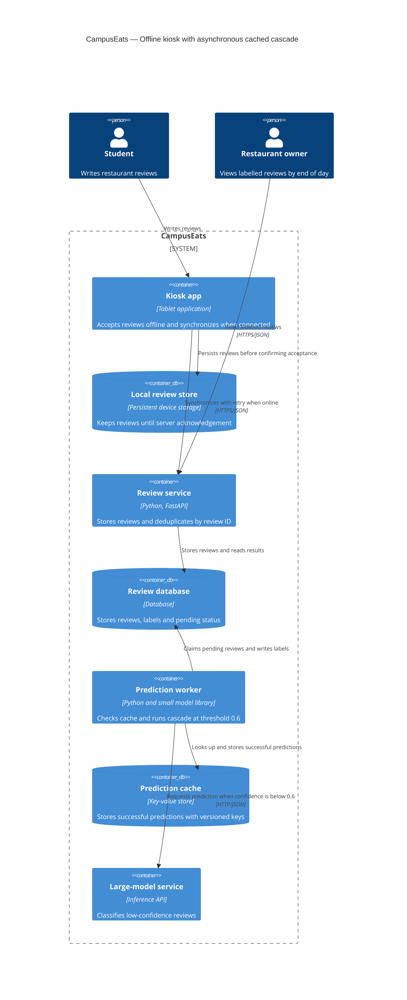

# Task 4: Deployment topologies and trade-offs

**Name / ชื่อ:** Chayutphong Soisri

**Student ID / รหัสนิสิต:** 6630054621

This is **individual work**: each student completes and submits their own copy, in their own fork.

*งานนี้เป็น**งานเดี่ยว** นิสิตแต่ละคนทำและส่งงานของตัวเอง ใน fork ของตัวเอง*

**Scenario (A, B or C) / Scenario ที่เลือก:** B — Canteen kiosk

Choose **one** scenario below. If the last digit of your student ID is odd, take A or B; if it is even, take B or C. Use your measurements from Tutorial 6 as evidence: cite run names from `results/runs.csv`. Answer in Thai or English.

เลือก scenario **หนึ่ง** ข้อด้านล่าง ถ้าเลขตัวสุดท้ายของรหัสนิสิตเป็นเลขคี่ ให้เลือก A หรือ B ถ้าเป็นเลขคู่ ให้เลือก B หรือ C ใช้ผลการวัดจาก tutorial ที่ทำไปเป็นข้อมูลอ้างอิง โดยอ้างชื่อ run จาก `results/runs.csv` จะตอบเป็นภาษาไทยหรือภาษาอังกฤษก็ได้

Facts that hold in every scenario / ข้อเท็จจริงที่ใช้กับทุก scenario:

- The large model serves at most **20 calls per second** (4 calls at once × about 200 ms each), and every call costs money.

  *large model รับได้สูงสุด **20 calls ต่อวินาที** (พร้อมกัน 4 calls × ประมาณ 200 ms ต่อ call) และทุก call มีค่าใช้จ่าย*
- The small model is fast and cheap enough to run anywhere, including inside the review service or on a kiosk, but it is much less accurate on its own.

  *small model เร็วและถูกพอที่จะรันที่ไหนก็ได้ รวมถึงภายใน review service หรือบน kiosk แต่ถ้าใช้ตัวเดียวจะแม่นน้อยกว่ามาก*

## Scenarios

**A. Owner alerts.** When a customer posts a negative review, the restaurant owner gets a push notification within **2 seconds**. At the lunch peak, CampusEats receives **40 reviews per second**. A missed alert is acceptable, but a wrong alert (for example, "your customer is unhappy" when they are happy) makes owners stop trusting alerts and, in the end, ignore them.

*เมื่อลูกค้าโพสต์รีวิวเชิงลบ เจ้าของร้านจะต้องได้รับ push notification ภายใน **2 วินาที** เวลาช่วงพีคตอนเที่ยง CampusEats ได้รับรีวิวจำนวน **40 รายการต่อวินาที** การพลาด alert ไปบ้างนั้นยอมรับได้ แต่ alert ที่ผิด (เช่น "ลูกค้าไม่พอใจ" ทั้งที่จริงๆ แล้วพอใจ) จะทำให้เจ้าของร้านไม่เชื่อถือและเลิกสนใจ alert ในที่สุด*

**B. Canteen kiosk.** A tablet in each canteen lets students leave a review on the spot. However, the canteen Wi-Fi is poor: the tablets lose their connection several times a day, for minutes at a time. The system must accept every review, even while a tablet is offline. Restaurant owners need the labels **by the end of the day**.

*มี tablet ในแต่ละโรงอาหารให้นิสิตรีวิวได้ทันที อย่างไรก็ดี การเชื่อมต่อ Wi-Fi ในโรงอาหารไม่ดี ทำให้ tablet หลุดการเชื่อมต่อวันละหลายครั้ง ครั้งละหลายนาที ระบบจะต้องรับรีวิวได้ทุกรายการแม้ขณะที่กำลัง offline อยู่ และเจ้าของร้านต้องการ label **ภายในสิ้นวัน***

**C. Weekly report.** Restaurant owners want a weekly sentiment report. Nothing in producing this report has to be real-time. **Accuracy matters most** and **cost must be minimal**.

*เจ้าของร้านต้องการรายงาน sentiment รายสัปดาห์ ไม่มีอะไรที่จะต้องทำแบบ real-time ในการออกรายงานนี้ ความแม่นยำ **(accuracy) สำคัญที่สุด** และ **ค่าใช้จ่ายต้องน้อยที่สุด***

## Topologies and patterns to choose from / Topology และ pattern ที่เลือกใช้ได้

| | Topology | Where the model runs / โมเดลรันที่ไหน |
|---|---|---|
| T1 | Model as a service, synchronous | Inference service, called for each review (today's baseline) *inference service ถูกเรียกทุกรีวิว (baseline ของวันนี้)* |
| T2 | Model as a library | Inside the review service, or on the device *ภายใน review service หรือบนอุปกรณ์* |
| T3 | Hybrid | Small model locally, large model as a remote service *small model รันในเครื่อง large model เป็น remote service* |
| T4 | Asynchronous / batch | Reviews are queued (broker, W10) or stored, and scored later in bulk *รีวิวถูกเข้าคิว (broker, W10) หรือเก็บไว้ แล้วติด label ทีหลังเป็นชุด* |

Combine one topology with any of the patterns from Tutorial 6: **fallback**, **cascade** and **cache**.

*เลือก topology หนึ่งแบบ แล้วผสมกับ pattern จาก Tutorial 6 ได้ตามต้องการ: **fallback**, **cascade** และ **cache***

## 1. Quality requirements

The three most important quality requirements for your scenario, each with a number where possible.

*quality requirements ที่สำคัญที่สุด 3 ข้อของ scenario ที่เลือก ระบุตัวเลขเมื่อทำได้*

ตัวเลขด้านระยะเวลา offline ความจุ และเวลาส่งข้อมูลเป็นเป้าหมายการออกแบบที่เสนอเพิ่มเติมจากโจทย์

| # | Quality | Requirement |
|---|---|---|
| 1 | Offline availability | Tablet ต้องรับรีวิวขณะ offline ได้อย่างน้อย 30 นาที และเก็บรีวิวรอส่งได้อย่างน้อย 1,000 รายการต่อเครื่อง |
| 2 | Reliability / Data integrity | รีวิวที่ยืนยันว่าบันทึกแล้วต้องสูญหาย 0 รายการ และการส่งซ้ำต้องไม่สร้างรีวิวซ้ำใน server |
| 3 | Timeliness and accuracy | รีวิวที่ส่งถึง server ภายใน 23:00 ต้องได้รับ label ภายใน 23:59 โดยตั้งเป้า accuracy ≥ 90% บนชุดทดสอบที่เป็นตัวแทนการใช้งานจริง |

เลือกแบบที่ใช้ **large-model calls ต่ำที่สุดภายใต้ข้อกำหนดเหล่านี้** เพื่อลดต้นทุน ทั้งนี้ หาก tablet ยัง offline จนเลยกำหนดส่ง ระบบต้องเก็บรีวิวไว้ แต่ไม่สามารถรับประกันว่าจะติด label ทันสิ้นวันได้

## 2. Design / การออกแบบ

Your topology, the patterns you add, and a container-level diagram (C4 level 2). The C4 diagram must be written in Mermaid.

*topology ที่เลือก pattern ที่เพิ่ม และ diagram ระดับ container (C4 level 2) เขียนด้วย Mermaid*

เลือก **T4: Asynchronous / batch** ร่วมกับ **cache, cascade threshold 0.6 และ fallback/retry**

Tablet สร้าง review ID และบันทึกรีวิวลง persistent local storage ก่อนยืนยันว่ารับรีวิวแล้ว เมื่อเชื่อมต่อได้จึงส่งไปยัง review service โดย server ใช้ review ID ป้องกันข้อมูลซ้ำ Tablet จะนำรีวิวออกจากรายการรอส่งเมื่อ server ยืนยันว่าบันทึกสำเร็จแล้วเท่านั้น

ฝั่ง server บันทึกรีวิวเป็น pending และให้ background worker ประมวลผลภายหลัง โดยตรวจ prediction cache ก่อน หากไม่พบจึงเรียก small model ภายใน worker และส่งต่อไปยัง large-model service เมื่อ confidence ต่ำกว่า 0.6 จากนั้นบันทึก label และเก็บผลทำนายที่สำเร็จลง cache โดยไม่เก็บ pending เป็นผลทำนายสำเร็จ

Cache key ประกอบด้วยข้อความที่ปรับตัวพิมพ์และช่องว่างให้เป็นมาตรฐาน รวมถึงเวอร์ชันของชุดโมเดลและการตั้งค่า cascade เพื่อป้องกันการใช้ผลเก่าหลังเปลี่ยนโมเดลหรือ threshold

**เหตุผลเลือก threshold 0.6:** ผล `t2-0.6` มี accuracy 91.5% ผ่านเป้าหมาย ≥ 90% และใช้ large model เพียง 38% ซึ่งต่ำที่สุดใน threshold ที่ทดลอง เมื่อเพิ่ม cache ผล `t3-cache` ยังคงมี accuracy 91.5% แต่ large calls ลดเหลือ 31% อย่างไรก็ตาม ผลจาก 200 รีวิวมีส่วนเผื่อเหนือเกณฑ์เพียง 1.5 percentage points จึงต้องตรวจสอบกับข้อมูลจริงเพิ่มเติม

**Timeout และ retry:** ใช้ timeout 1 วินาทีเป็นค่าเริ่มต้นเพื่อไม่ให้งานที่ค้างยึด slot ของ worker นานเกินไป โดย `t0-large` มี p95 = 594 ms หาก timeout หรือเกิด error ให้คงสถานะ pending และลองใหม่ด้วย backoff ค่านี้ยังต้องทดสอบใน batch worker จริง เพราะผล `t1-after` วัดเส้นทาง synchronous และการ timeout ฝั่ง worker ไม่ได้ยืนยันว่าจะยกเลิกงานที่ inference service ได้ด้วย

## 3. Evidence / หลักฐาน

Which runs support your choice? Show the numbers and, for scenario A, the capacity arithmetic: how many large-model calls per second does your design need at the peak?

*run ไหนที่สนับสนุนการตัดสินใจของนิสิต ให้นิสิตแสดงตัวเลขประกอบ และสำหรับ scenario A ให้นิสิตแสดงการคำนวณ capacity ด้วย เพื่อแสดงว่าในช่วงพีคนั้น design ของนิสิตต้องใช้ large model กี่ calls ต่อวินาที*

| Run | What it shows / แสดงอะไร |
|---|---|
| `t0-small` | accuracy 72.5% ไม่ผ่านเป้าหมาย ≥ 90% จึงไม่เลือก small model เพียงตัวเดียว |
| `t0-large` | accuracy 93.5% แต่เรียก large model 100% ใช้เป็นจุดอ้างอิงด้านความแม่นยำและต้นทุน |
| `t2-0.6` | accuracy 91.5%, large calls 38%, p50 = 6 ms และ p95 = 553 ms ผ่านเกณฑ์ด้วยจำนวน large calls ต่ำที่สุดใน threshold ที่ทดลอง |
| `t2-0.7` | accuracy 93.0% แต่เรียก large model 53% จึงมีต้นทุนสูงกว่า 0.6 แม้ทั้งสองแบบผ่านเกณฑ์ที่ตั้งไว้ |
| `t3-cache` ที่ threshold 0.6 | accuracy 91.5% เท่ากับ `t2-0.6` แต่ large calls ลดจาก 38% เหลือ 31% สนับสนุนการเพิ่ม cache |
| `t1-after` | errors ลดจาก 20 เป็น 0 และมี pending 27 รายการ สนับสนุน fallback เพื่อเก็บรีวิวไว้ประมวลผลต่อ แต่ยังไม่พิสูจน์ว่า retry จะเสร็จทันสิ้นวัน |

**Capacity:** ตามโจทย์ large model รองรับได้ประมาณ 20 calls/วินาที เมื่อใช้ large model 31% ประเมินเพดาน throughput ได้เป็น

$$
\text{Throughput} \approx \frac{20}{0.31} \approx 64.5\ \text{reviews/s}
$$

ตัวอย่าง backlog 1,000 รีวิว หากมีรูปแบบ cache hits เหมือนผลทดลอง จะต้องเรียก large model ประมาณ 310 ครั้ง ใช้เวลาส่วน large model ในอุดมคติประมาณ

$$
\frac{310}{20} = 15.5\ \text{s}
$$

ช่วง cache ว่างควรประเมินจาก `t2-0.6` ที่ large calls 38% แทน ซึ่งได้ประมาณ 52.6 reviews/s หรือ 19 วินาทีสำหรับส่วน large model ของ backlog 1,000 รีวิว

ตัวเลขเหล่านี้เป็นการประมาณจาก capacity ตามโจทย์ ยังไม่รวม synchronization, database, small-model processing, retry และงานจาก tablet อื่น จึงต้องทดสอบ backlog รวมและติดตามอายุของ pending เพื่อยืนยันว่าจะทำงานทันสิ้นวัน

## 4. ADR

Use the ADR format from W5.

*ใช้รูปแบบ ADR จาก W5*

**Title:** รับรีวิวแบบ offline และติด label ภายหลังด้วย asynchronous cached cascade

**Status:** Proposed

**Context:**  
Wi-Fi ในโรงอาหารหลุดวันละหลายครั้ง ครั้งละหลายนาที แต่ระบบต้องรับรีวิวได้ทุกครั้งและให้ label ภายในสิ้นวัน การรับรีวิวจึงไม่ควรขึ้นกับการเชื่อมต่อ inference service ขณะนั้น นอกจากนี้ large model มีค่าใช้จ่ายและรองรับได้ประมาณ 20 calls/วินาที จึงต้องลดการเรียกโดยรักษา accuracy ตามเป้าหมาย

**Decision:**  
เลือก T4: Asynchronous / batch โดยเก็บรีวิวบน tablet ก่อนส่งไปยัง server เมื่อเชื่อมต่อได้ ใช้ review ID ป้องกันข้อมูลซ้ำ และให้ background worker ตรวจ cache ก่อนทำ cascade ที่ threshold 0.6 ใช้ cache key ที่รวมเวอร์ชันโมเดลและการตั้งค่า หาก inference ล้มเหลวให้คง pending และ retry ด้วย backoff พร้อมติดตาม backlog เพื่อให้ประมวลผลทันกำหนด

**Consequences:**

- **Positive:** รับรีวิวขณะ offline ได้ ผู้ใช้ไม่ต้องรอ inference และใช้ cache ร่วมกันระหว่าง tablet ได้ ผล `t3-cache` มี accuracy 91.5% และเรียก large model 31% เทียบกับ baseline ที่เรียก 100%
- **Negative:** label ไม่พร้อมทันที ระบบมีความซับซ้อนเพิ่มจาก synchronization, deduplication, cache และ retry อีกทั้ง accuracy 91.5% ยังไม่รับประกันว่าจะเกิน 90% บนข้อมูลจริง ช่วงเปลี่ยนโมเดล cache จะว่างและภาระ inference อาจเพิ่มขึ้น ส่วน tablet ที่ offline จนเลยกำหนดอาจส่งรีวิวไม่ทันสิ้นวัน

**Alternatives considered:** at least one topology you rejected, and why.

*อย่างน้อยหนึ่ง topology ที่ไม่เลือก และเหตุผล*

> - **T1: Model as a service, synchronous:** ไม่เลือก เพราะการติด label ต้องพึ่งเครือข่ายขณะส่งรีวิว หากต้องรองรับ offline จะต้องเพิ่ม local storage และการส่งภายหลังอยู่ดี
> - **T2: Model as a library โดยใช้ small model อย่างเดียว:** ทำงาน offline ได้ แต่ `t0-small` มี accuracy 72.5% ไม่ผ่านเป้าหมาย
> - **T3: Hybrid โดยรัน small model บน tablet:** ให้ผลบางส่วนขณะ offline ได้ แต่รีวิวที่ confidence ต่ำยังต้องรอเชื่อมต่อเพื่อเรียก large model และต้องดูแลเวอร์ชันโมเดลบนทุก tablet สำหรับ scenario นี้ที่ไม่ต้องได้ label ทันที จึงเลือก T4 เพื่อจัดการโมเดล คิวงาน และ cache ร่วมกันที่ส่วนกลาง
